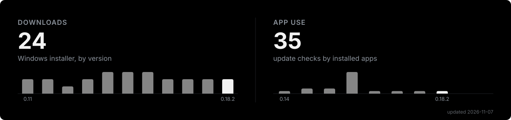

<p align="center">
  
</p>

<p align="center">
  Firing calculator for mortars, howitzers and rocket artillery in Arma 3 with ACE3.<br>
  Elevation, azimuth, charge and time of flight from the range tables of the game.
</p>

<p align="center">
  <a href="https://heisdevoid.github.io/multipurpose-artillery-calculator/"><b>Open the website</b></a>
  &nbsp;·&nbsp;
  <a href="https://github.com/HeisDevoid/multipurpose-artillery-calculator/releases/latest"><b>Download for Windows</b></a>
</p>

<h2 align="center">Frontend</h2>

<p align="center">
  
  
  
  
  
</p>

<h2 align="center">Desktop</h2>

<p align="center">
  
  
</p>

<h2 align="center">Link &amp; Tools</h2>

<p align="center">
  
  
  
  
  
  
</p>

## How to use

**Website.** Open [heisdevoid.github.io/multipurpose-artillery-calculator](https://heisdevoid.github.io/multipurpose-artillery-calculator/) in any modern browser. On a phone, pick “Add to Home Screen” (or “Install app”) in the browser menu: the calculator installs like an app and works offline.

**Windows app.** Download `ArtilleryCalculator_<version>_x64-setup.exe` from [the latest release](https://github.com/HeisDevoid/multipurpose-artillery-calculator/releases/latest) and run it. The app shows an overlay on top of the game, has global hotkeys and updates itself. The installer is not code-signed yet, so Windows SmartScreen may warn you: click “More info”, then “Run anyway”.

## Build from source

You need [Node.js](https://nodejs.org) 22 or newer and [Git](https://git-scm.com).

```bash
git clone https://github.com/HeisDevoid/multipurpose-artillery-calculator.git
cd multipurpose-artillery-calculator/web
npm install
npm run maps:pull
npm run dev
```

`npm run dev` starts the site at `http://localhost:5173`. `npm run maps:pull` downloads the built-in maps from the `maps` branch: they are kept out of the main history because of their size.

| Command | What it does |
| --- | --- |
| `npm run build` | Builds the website into `web/dist` |
| `npm test` | Unit tests (Vitest) |
| `npm run test:e2e` | Browser tests against the built site (run `npx playwright install chromium` once) |
| `npm run desktop:build` | Builds the Windows installer into `web/src-tauri/target/release/bundle/nsis` |

The Windows app also needs [Rust](https://rustup.rs) and the [Visual Studio C++ Build Tools](https://visualstudio.microsoft.com/visual-cpp-build-tools/).

## Special thanks

- [ACE3](https://github.com/acemod/ACE3): its artillery range tables are what the calculator is built on.
- [grad_meh](https://github.com/gruppe-adler/grad_meh) by Gruppe Adler: satellite images, heights and roads of the built-in maps come from its exports.

## Stats

<p align="center">
  
</p>

## License

[MIT](LICENSE) © [HeisDevoid](https://github.com/HeisDevoid)
